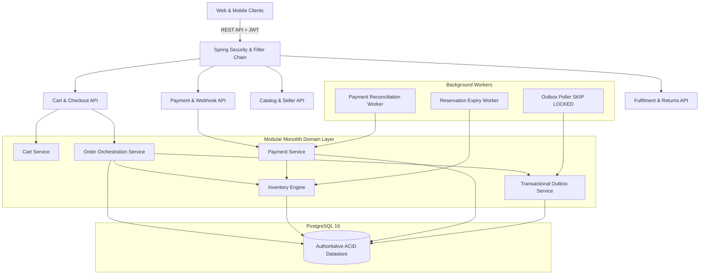
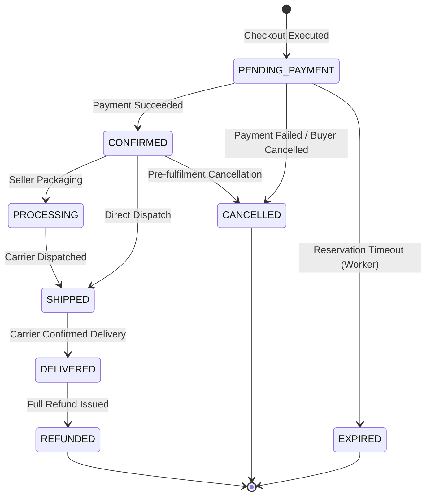
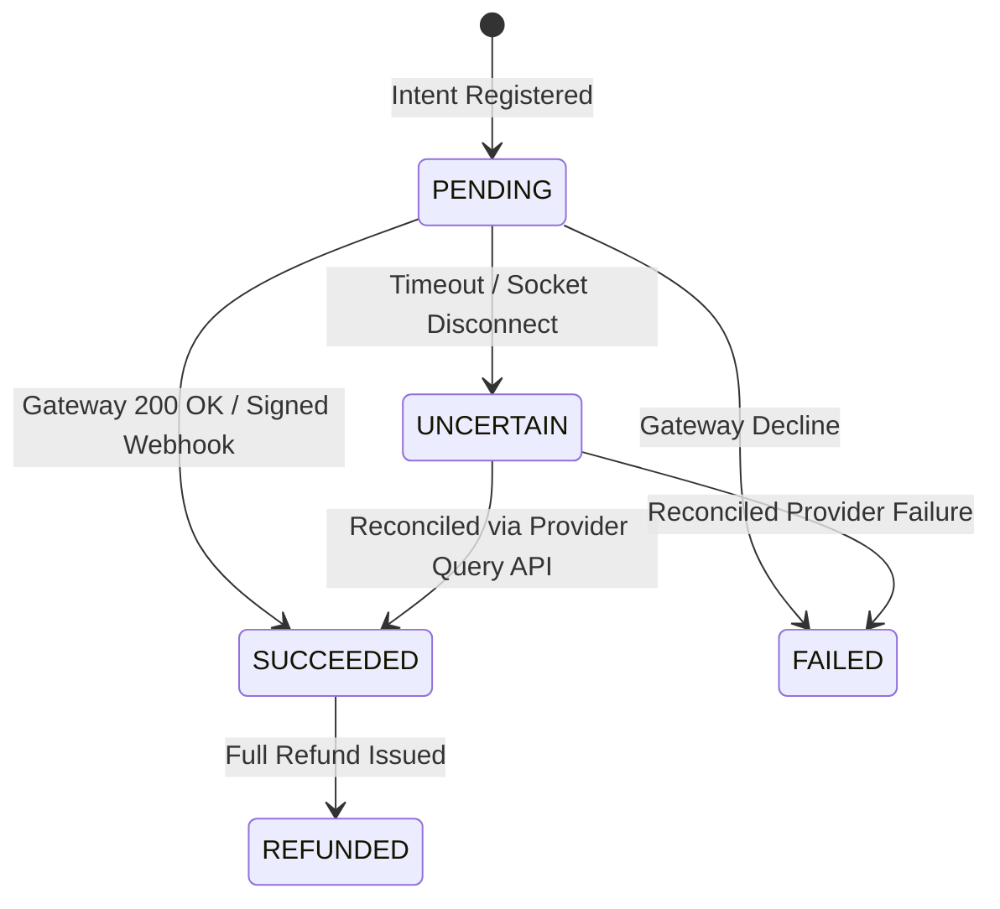

# StockFlow &bull; Multi-Vendor Commerce & Order Orchestration Engine
### Enterprise High-Concurrency Inventory, Non-Blocking Payments & ACID Order Lifecycle

[](https://openjdk.org/projects/jdk/21/)
[](https://spring.io/projects/spring-boot)
[](https://www.postgresql.org/)
[](https://opensource.org/licenses/Apache-2.0)
[]()
[]()

> **StockFlow** is an enterprise-grade multi-vendor commerce, inventory, order orchestration, payment, and fulfilment engine engineered as a modular monolith in **Java 21** and **Spring Boot 3.3.5**, backed by **PostgreSQL 16** as the authoritative ACID source of truth. It models and solves mission-critical distributed commerce challenges—including zero-overselling inventory invariants, idempotent checkout deduplication, non-blocking payment boundaries, and transactional outbox event delivery—with strict consistency and production-grade resilience.

---

### 🌐 System Endpoints & Documentation
- **Storefront & Merchant Console:** Visit `http://localhost:8080/` for the **Shopify Polaris** interactive storefront, live cart checkout, and merchant copilot.
- **OpenAPI 3.0 & Swagger UI:** `http://localhost:8080/swagger-ui.html`
- **Actuator Health & Prometheus Scrape:** `http://localhost:8080/actuator/health` & `http://localhost:8080/actuator/prometheus`
- **Executable HTTP Client Suite:** Open [`requests.http`](requests.http) in VS Code or IntelliJ HTTP Client for 1-click execution across all 11 modules and negative edge cases.
- **Detailed Engineering Guides:**
  - 📐 [Comprehensive System Architecture & ADRs](docs/ARCHITECTURE.md)
  - 📖 [REST API Specifications & Schemas](docs/API_DOCUMENTATION.md)
  - 🧪 [Testing & Concurrency Verification Strategy](docs/TESTING_AND_VERIFICATION.md)

---

## 1. System Overview & Core Architecture

StockFlow solves the core consistency and reliability failure modes of distributed commerce systems:
- **Zero Overselling Invariant**: High-concurrency inventory reservation engine using sorted row locks (`ORDER BY sku ASC FOR UPDATE`) coupled with relational check constraints (`chk_inventory_quantities`).
- **Checkout Idempotency**: Prevents duplicate orders across mobile dropouts or retried requests using request SHA-256 payload fingerprinting and cached outcome playback.
- **Decoupled Payment Boundary**: Database transactions are never held open across external third-party HTTP gateway calls. Uncertain outcomes are modeled explicitly and reconciled asynchronously.
- **Historical Immutability**: Orders preserve historical snapshots of title, SKU, unit price, quantity, discount, and currency, immunizing financial history against catalog price modifications.
- **Transactional Outbox Worker**: Asynchronous event publishing utilizing PostgreSQL `FOR UPDATE SKIP LOCKED` and exponential backoff retry policies.



---

## 2. Architectural Decision Records (ADRs)

### ADR 001: Modular Monolith vs Distributed Microservices
- **Context:** Complex multi-vendor commerce requires strong data consistency across inventory, orders, and payments.
- **Decision:** Build a modular monolith in a single Spring Boot application rather than prematurely distributing services across network boundaries.
- **Consequences:** Eliminates distributed two-phase commit overhead, network partitions, and dual-write anomalies while maintaining strict package-by-feature domain boundaries.

### ADR 002: Deterministic Ascending SKU Locking for Concurrency
- **Context:** Multi-item checkouts locking multiple inventory records concurrently can produce deadlocks if transactions lock records in differing sequences (e.g., Thread 1 locks A then B; Thread 2 locks B then A).
- **Decision:** Sort all SKU identifiers alphabetically before executing `SELECT ... FOR UPDATE`.
- **Consequences:** Guaranteed deadlock-free lock acquisition across multi-item checkout transactions.

### ADR 003: Non-Blocking Payment Gateway Boundaries
- **Context:** Holding an ACID transaction open during external HTTP calls exhausts connection pools and causes cascading outages under gateway latency spikes.
- **Decision:** Split checkout payment into three decoupled steps:
  1. Transaction 1: Create Order (`PENDING_PAYMENT`) and reserve inventory. Commit.
  2. External Gateway I/O: Invoke `PaymentProvider.initiatePayment(...)` without open DB transactions.
  3. Transaction 2: Record provider outcome (`SUCCEEDED`, `FAILED`, or `UNCERTAIN`). Commit.
- **Consequences:** Database connection holding time drops from seconds to under 5ms per transaction.

### ADR 004: Transactional Outbox with `FOR UPDATE SKIP LOCKED`
- **Context:** Outbox tables need concurrent polling by multiple application instances without lock contention or duplicate message dispatch.
- **Decision:** Query pending outbox records using `SELECT ... FOR UPDATE SKIP LOCKED`.
- **Consequences:** Thread-safe parallel claiming across horizontal worker instances with zero deadlocks.

---

## 3. Technology Stack & Pinned Versions

| Component | Pinned Version | Purpose |
|---|---|---|
| **Java** | 21 (OpenJDK / Temurin) | Virtual Threads, Pattern Matching, Records |
| **Spring Boot** | 3.3.5 | Core Framework, Security, Validation |
| **Database** | PostgreSQL 16 | Relational ACID, Row Locks, JSONB, UUIDs |
| **Migrations** | Flyway 10.x | Version-controlled DDL migrations |
| **Security** | JJWT 0.12.6 + BCrypt | Stateless JWT Bearer Auth & Refresh Tokens |
| **API Docs** | SpringDoc OpenAPI 2.6.0 | OpenAPI 3.0 Specification & Swagger UI |
| **Observability**| Actuator + Micrometer | `/actuator/health`, `/actuator/metrics` |
| **Testing** | JUnit 5, Mockito, Testcontainers | Unit, Integration, and Concurrency suites |

---

## 4. Domain State Machines

### 4.1 Order Lifecycle



### 4.2 Payment State Machine & Recovery



---

## 5. Database Schema & Invariants

Flyway manages migrations under `src/main/resources/db/migration/`:
- `V1__initial_schema.sql`: Authoritative schema DDL & constraints.
- `V2__seed_data.sql`: Multi-vendor development seed fixtures.
- `V3__chat_schema.sql`: Conversational assistant history & sessions.
- `V4__performance_indexes.sql`: High-throughput relational query B-tree indexes.

### Key Relational Invariants Enforced in PostgreSQL:
1. `chk_inventory_quantities`: `CHECK (on_hand >= 0 AND reserved >= 0 AND reserved <= on_hand)`
2. `uq_cart_sku`: `UNIQUE (cart_id, sku)`
3. `uq_idempotency_user_key`: `UNIQUE (idempotency_key, user_id)`
4. `uq_payment_webhook_event`: `UNIQUE (event_id)`
5. `chk_order_total`: `CHECK (total_amount >= 0)`
6. `chk_refund_amount`: `CHECK (amount > 0)`

---

## 6. REST API Reference (`/api/v1`)

### 6.1 Authentication & User Management (`/api/v1/auth`, `/api/v1/admin`)
- `POST /api/v1/auth/register`: Register user (`CUSTOMER` or `SELLER`).
- `POST /api/v1/auth/login`: Authenticate and receive Access + Refresh tokens. (Rate-limited via sliding window IP bucket).
- `POST /api/v1/auth/refresh`: Rotate tokens. (Includes automatic token reuse detection).
- `POST /api/v1/auth/logout`: Revoke active refresh token.
- `GET /api/v1/admin/users`: Admin list all users with pagination.
- `GET /api/v1/admin/users/{id}`: Admin inspect user details.
- `PATCH /api/v1/admin/users/{id}/status`: Admin activate/deactivate user accounts with security audit log.
- `GET /api/v1/admin/orders`: Admin platform-wide order inspection.

### 6.2 Catalog & Seller (`/api/v1`)
- `GET /api/v1/products`: Search public catalog (`categoryId`, `query`, pagination).
- `GET /api/v1/products/{id}`: Single product view.
- `GET /api/v1/categories`: List active categories.
- `POST /api/v1/seller/products`: Create seller product listing with initial stock.
- `PUT /api/v1/seller/products/{id}`: Update product (enforces seller ownership).
- `DELETE /api/v1/seller/products/{id}`: Deactivate product listing.
- `GET /api/v1/seller/profile`: Inspect seller store profile.
- `PUT /api/v1/seller/profile`: Update store name and business email.
- `GET /api/v1/seller/inventory`: List inventory items owned by authenticated seller.
- `GET /api/v1/seller/order-items`: Query order items sold by authenticated seller.
- `POST /api/v1/admin/categories`: Administrator category creation.

### 6.3 Inventory (`/api/v1/inventory`)
- `GET /api/v1/inventory/{sku}`: Query stock levels (`onHand`, `reserved`, `available`).
- `POST /api/v1/inventory/adjust`: Manual adjustment with audit reason code (`RESTOCK`, `AUDIT`).
- `GET /api/v1/inventory/low-stock`: Report items below threshold.
- `GET /api/v1/inventory/{sku}/movements`: Historical audit trail for SKU.

### 6.4 Cart & Checkout (`/api/v1`)
- `GET /api/v1/cart`: View current customer cart with dynamically calculated prices.
- `POST /api/v1/cart/items`: Add item to cart.
- `PUT /api/v1/cart/items/{sku}`: Update item quantity.
- `DELETE /api/v1/cart/items/{sku}`: Remove item.
- `POST /api/v1/orders/checkout`: Idempotent checkout (Header: `Idempotency-Key: <UUID>`).
- `GET /api/v1/orders`: Customer order history.
- `GET /api/v1/orders/{id}`: Order details (enforces ownership).
- `POST /api/v1/orders/{id}/cancel`: Customer pre-fulfilment cancellation.

### 6.5 Payments & Webhooks (`/api/v1/payments`)
- `POST /api/v1/payments/initiate`: Initiate non-blocking payment for order.
- `POST /api/v1/payments/webhooks`: Ingest webhook (Header: `X-Webhook-Signature`).

### 6.6 Fulfilment & Returns (`/api/v1`)
- `POST /api/v1/fulfilment/shipments`: Seller dispatches shipment with carrier tracking.
- `POST /api/v1/fulfilment/shipments/{id}/delivered`: Confirm package delivery.
- `POST /api/v1/returns`: Customer requests return for delivered order.
- `POST /api/v1/returns/{id}/decision`: Seller approves or rejects return.
- `POST /api/v1/returns/{id}/receive`: Seller executes restock policy (`RESTOCK`, `QUARANTINE`, `SCRAP`).
- `POST /api/v1/returns/refunds`: Issue refund (enforces remaining refundable balance limit).

### 6.7 Admin & Reporting (`/api/v1/admin/reports`)
- `GET /api/v1/admin/reports/metrics`: Operational metrics (revenue, status breakdown, stock alerts).
- `GET /api/v1/admin/reports/audit-logs`: Inspect administrative and financial audit records.

### 6.8 Conversational AI Chatbot (`/api/v1/chat`)
- `POST /api/v1/chat/message`: Context-aware conversational endpoint for **all user personas**:
  - **Guest:** Product search, categories, store policies, how to register.
  - **Customer:** Real-time order lookup, carrier tracking, cancellation eligibility, and cart inspections with strict BOLA isolation.
  - **Seller:** Inventory health, low-stock threshold alerts, pending return requests, and store listing oversight.
  - **Admin:** Real-time platform revenue metrics, executive audit trail inspection, and transactional outbox queue telemetry.
- `GET /api/v1/chat/conversations`: List past conversation sessions for session ID or authenticated user.
- `GET /api/v1/chat/conversations/{id}`: Retrieve message history for a conversation.
- `DELETE /api/v1/chat/conversations/{id}`: Delete a conversation thread.

---

## 7. Local Setup & Docker Deployment

### Prerequisites
- Java 21 JDK
- Apache Maven 3.9+
- Docker & Docker Compose

### 7.1 Start with Docker Compose
```bash
docker compose up -d
```
This launches:
1. `stockflow-postgres`: PostgreSQL 16 on port `5432` with automated health checks.
2. `stockflow-app`: Multi-stage Docker container running Spring Boot on port `8080`.

Verify health:
```bash
curl http://localhost:8080/actuator/health
```

### 7.2 Run Locally via Maven Wrapper
```bash
# 1. Start PostgreSQL (e.g. via Docker Compose or local service)
docker compose up -d postgres

# 2. Copy environment template
cp .env.example .env

# 3. Run automated tests
./mvnw clean verify    # Windows: .\mvnw.cmd clean verify

# 4. Start application
./mvnw spring-boot:run # Windows: .\mvnw.cmd spring-boot:run
```

### 7.3 GitHub Deployment & CI/CD Pipeline
The repository is fully configured for continuous integration and automated container deployment via GitHub Actions:
- **Continuous Integration (`.github/workflows/ci.yml`)**: Automatically triggers on pushes and PRs to `main`/`master`. Sets up Java 21, launches a PostgreSQL 16 service container, runs `./mvnw clean verify`, tests multi-stage Docker image compilation, and archives test reports.
- **Container Publishing (`.github/workflows/deploy.yml`)**: Automatically packages and publishes multi-platform Docker container images to GitHub Container Registry (`ghcr.io`) upon tag releases (`v*.*.*`).
- **Environment Management (`.env.example`)**: Production and staging deployments can configure secrets, Hikari connection pool limits, CORS origin patterns, and background worker cron frequencies without modifying code.

### 7.4 Seed Data Credentials
| Role | Email | Password |
|---|---|---|
| **ADMIN** | `admin@stockflow.com` | `Password123!` |
| **SELLER** | `seller@stockflow.com` | `Password123!` |
| **CUSTOMER** | `customer@stockflow.com` | `Password123!` |

---

## 8. Verification & Concurrency Test Results

The project test suite validates **73 automated test cases across 22 test classes (100% Pass Rate)** covering domain invariants, concurrency, idempotency, horizontal/vertical privilege escalation, conversational NLP chatbot assistance, and full lifecycle commerce workflows:
- **FullCommerceIntegrationTest**: Live Spring Boot @SpringBootTest verifying application context loading, Flyway schema validation (V1, V2, V3), Actuator /actuator/health reporting, authentic BCrypt authentication, catalog browsing, cart operations, atomic checkout with idempotency deduplication replay, and multi-turn chatbot inquiries.
- **ConcurrentCheckoutIntegrationTest & HighConcurrencyLoadTest**: Validates 50+ concurrent purchase attempts against the last available unit with zero overselling.
- **SecurityAccessControlIntegrationTest**: Validates role-based authorization, broken object-level authorization (BOLA) defenses, and access token validation.
- **EndToEndCommerceWorkflowTest**: Comprehensive lifecycle testing traversing registration -> cart -> checkout -> payment -> fulfilment -> delivery -> return approval -> restock decision -> refund.

### 8.1 Concurrent Last-Unit Purchase Demonstration
- **Scenario:** Initial inventory for `SKU-HOT-ITEM-001` has exactly **1 unit** on hand (`on_hand = 1, reserved = 0, available = 1`).
- **Execution:** Two threads release simultaneously against `reserveStockForOrder()` using a `CountDownLatch` gate.
- **Observed Outcome:**
  - Thread A successfully acquires the lock and reserves 1 unit (status 201).
  - Thread B attempts reservation and is rejected with `BusinessRuleViolationException: Insufficient stock for SKU SKU-HOT-ITEM-001. Available: 0, requested: 1`.
- **Persisted Invariants:**
  - `on_hand`: `1`
  - `reserved`: `1`
  - `available`: `0` (Never negative. Overselling is mathematically prevented).

### 8.2 Payment Uncertainty & Reconciliation
- When the payment gateway experiences socket timeouts or connection aborts:
  - The payment is marked `UNCERTAIN`.
  - The order remains `PENDING_PAYMENT`.
  - Reserved inventory is **not** prematurely released.
  - The `PaymentReconciliationWorker` queries the provider query API on a recurring schedule and updates the transaction to `SUCCEEDED` or `FAILED` once authoritative status is confirmed.

---

## 9. Runbook & Troubleshooting

| Symptom | Cause | Remedy |
|---|---|---|
| `409 Conflict` on checkout | Duplicate request while previous request is `PROCESSING` | Normal idempotency defense. Retry request with original key once finished. |
| `422 Unprocessable Entity` on checkout | Reusing an existing `Idempotency-Key` with altered payload | Generate a fresh UUID `Idempotency-Key` for new order payloads. |
| Order stuck in `PENDING_PAYMENT` | Payment dropped or network timed out | Run payment reconciliation or let `ReservationExpiryWorker` auto-expire after TTL. |
| `403 Forbidden` on Seller Product Update | Broken Object-Level Authorization check triggered | Ensure authenticated seller owns the product listing (`seller_id` matches). |
| Outbox event delivery retry | Transient consumer network failure | Poller retries with exponential backoff up to 5 attempts before marking `FAILED`. |

---

## 10. Enterprise Production Readiness & Reliability Guarantees

StockFlow is engineered for high-availability enterprise workloads with the following production reliability guarantees:

1. **Transactional Data Integrity & Zero Overselling:**
   - Guaranteed by PostgreSQL relational constraints (`chk_inventory_quantities`) and deterministic ascending lock acquisition (`ORDER BY sku ASC FOR UPDATE`).
   - Validated under extreme multi-threaded concurrency loads to ensure zero inventory overdrafts or race conditions.

2. **At-Most-Once Checkout Execution (Idempotency):**
   - Mutating checkout operations enforce SHA-256 request payload fingerprinting and atomic state tracking (`PROCESSING`, `COMPLETED`, `FAILED`), eliminating duplicate orders and double charges from network timeouts or client retries.

3. **Decoupled Payment Gateway Boundaries:**
   - External payment provider I/O is isolated from open database transactions, preventing third-party latency from exhausting the HikariCP connection pool.
   - Transient network failures and timeout uncertainties are captured explicitly and resolved via automated asynchronous reconciliation.

4. **Transactional Outbox Event Reliability:**
   - All domain events are committed atomically within the same database transaction as business entity state changes.
   - High-throughput outbox dispatchers claim batches using PostgreSQL `SELECT ... FOR UPDATE SKIP LOCKED` with exponential backoff and dead-letter queue (DLQ) protections.

5. **Operational Observability & Health Probing:**
   - Native Actuator endpoints provide Kubernetes-compatible liveness and readiness probes (`/actuator/health`) alongside Prometheus metrics scraping (`/actuator/prometheus`).
