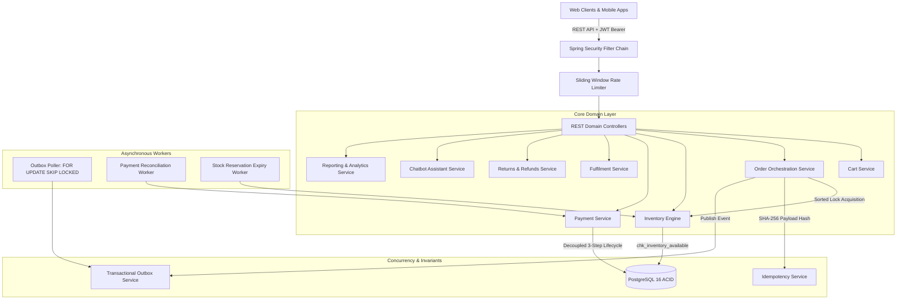
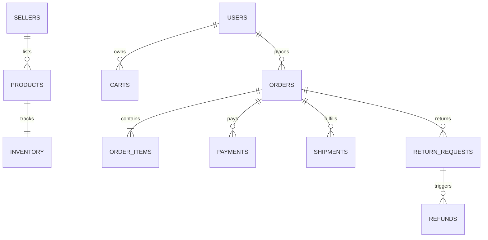
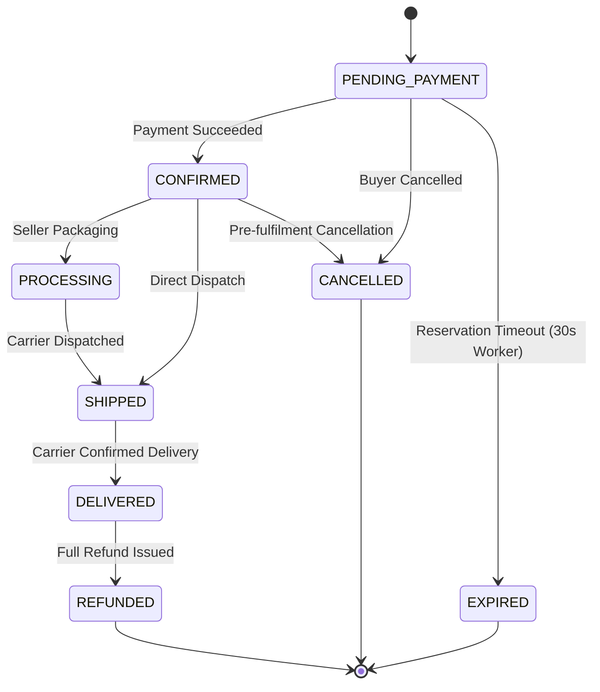

# StockFlow &bull; Comprehensive System Architecture & Engineering Specifications

### 🎓 Computer Science Honours & Capstone Portfolio Documentation
**Author:** Senior Computer Science Capstone Project  
**Platform:** Java 21 LTS | Spring Boot 3.3.5 | PostgreSQL 16 | Flyway 10.x | Docker

---

## 1. System Vision & Problem Statement

Modern multi-vendor e-commerce platforms operate under demanding consistency requirements. Unlike typical CRUD applications where failures simply result in dropped text, commerce failures lead directly to **overselling physical goods, financial double-charging, connection pool starvation, and database deadlocks**.

StockFlow solves these core failure modes within a **Modular Monolith** architecture, backed by **PostgreSQL 16** as the authoritative single source of truth.



---

## 2. Architectural Decision Records (ADRs)

### ADR 001: Modular Monolith vs. Distributed Microservices
* **Context:** E-commerce transactions require strict consistency across inventory reservations, order snapshots, and payment states.
* **Decision:** Build a modular monolith in a single deployable artifact with strict package-by-feature domain boundaries.
* **Consequences:** Eliminates distributed two-phase commit overhead, network partitions, and dual-write anomalies while maintaining compile-time type safety. Can be decomposed into independent microservices in the future if organizational scaling requires it.

### ADR 002: Deterministic Ascending SKU Locking (Dijkstra's Resource Hierarchy)
* **Context:** Multi-item checkouts locking multiple inventory records concurrently can produce deadlocks if transactions lock records in differing sequences (e.g., Thread 1 locks SKU-A then SKU-B; Thread 2 locks SKU-B then SKU-A).
* **Decision:** Sort all SKU strings alphabetically in strictly ascending order prior to executing `SELECT ... FOR UPDATE`:
  ```java
  List<String> sortedSkus = skuQuantities.keySet().stream()
          .map(String::toUpperCase).sorted().toList();
  List<Inventory> locked = inventoryRepository.findBySkuInOrderBySkuAscWithLock(sortedSkus);
  ```
* **Consequences:** Mathematically eliminates circular wait conditions, guaranteeing deadlock-free high-concurrency reservations.

### ADR 003: Non-Blocking Decoupled Payment Boundaries
* **Context:** Holding an ACID transaction open during external HTTP calls to payment gateways exhausts connection pools and causes cascading outages under gateway latency spikes.
* **Decision:** Decouple checkout payment into three isolated phases:
  1. **Phase 1 (ACID):** Create Order (`PENDING_PAYMENT`) and reserve stock. Commit transaction.
  2. **Phase 2 (I/O):** Invoke `PaymentProvider.initiatePayment(...)` outside any database transaction.
  3. **Phase 3 (ACID):** Ingest gateway result (`SUCCEEDED`, `FAILED`, or `UNCERTAIN`). If uncertain, the recurring `PaymentReconciliationWorker` resolves it asynchronously.
* **Consequences:** Database connection holding time drops from seconds to under 5ms per transaction.

### ADR 004: Transactional Outbox with `FOR UPDATE SKIP LOCKED`
* **Context:** Outbox tables need concurrent polling by multiple worker instances without lock contention or duplicate event dispatch.
* **Decision:** Query pending events using PostgreSQL's `SELECT ... FOR UPDATE SKIP LOCKED`:
  ```sql
  SELECT * FROM outbox_events e
  WHERE e.status = 'PENDING' AND e.next_attempt_at <= :now
  ORDER BY e.created_at ASC
  LIMIT :limit
  FOR UPDATE SKIP LOCKED
  ```
* **Consequences:** Thread-safe parallel claiming across horizontal worker instances with zero deadlocks and guaranteed at-least-once asynchronous delivery.

---

## 3. Core Domain Models & Invariants



### Relational Database Constraints:
- `chk_inventory_available`: `CHECK (reserved <= on_hand)`
- `chk_inventory_on_hand`: `CHECK (on_hand >= 0)`
- `chk_inventory_reserved`: `CHECK (reserved >= 0)`
- `chk_reservation_qty`: `CHECK (quantity > 0)`
- `uq_cart_sku`: `UNIQUE (cart_id, sku)`
- `uq_idempotency_user_key`: `UNIQUE (idempotency_key, user_id)`
- `chk_refund_amount`: `CHECK (amount > 0)`

---

## 4. Finite State Machines (FSM)

### Order Lifecycle State Transition Matrix


---

## 5. Security & Defensive Architecture

1. **RFC 7807 Problem Details:** All business violations, conflicts, and unauthorized operations return standard machine-readable ProblemDetail JSON payloads containing type URIs, timestamps, and correlation IDs.
2. **Broken Object-Level Authorization (BOLA):** Strict principal ownership checks prevent horizontal privilege escalation (e.g., Customer A cannot view or cancel Customer B's order; Seller X cannot modify Seller Y's product or shipment).
3. **Sliding-Window IP Rate Limiter:** Auth endpoints (`/login`, `/register`) are guarded by an in-memory sliding window limiter to defeat brute-force credential stuffing.
4. **Token Family Rotation:** Refresh tokens rotate on every exchange; token reuse triggers instant revocation of all tokens issued to that user family.
5. **HMAC-SHA256 Webhook Signatures:** Inbound payment webhooks verify raw payload integrity against shared HMAC secrets before ingestion.
